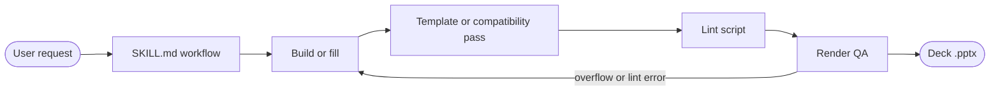

# whchoi Claude Code Plugin Marketplace

[](CHANGELOG.md)
<a href="#english"></a>
<a href="#korean"></a>

<!-- TODO: add a License badge once a LICENSE file is chosen -->

Claude Code skills for building AWS Korea PowerPoint decks | AWS Korea PowerPoint 덱을 만드는 Claude Code skill 모음

---

<a id="english"></a>

# English

## Overview

This marketplace (`whchoi`) distributes the `aws-deck` plugin, which gives Claude Code three ways to produce AWS-branded PowerPoint decks: seminar decks on the 2026 AWS templates, dense consulting-report decks, and filling a template you already have without changing its layout.

| Plugin | Skills |
|---|---|
| `aws-deck` | `aws-ppt-skills`, `consulting-ppt-white-ppt`, `pptx-template-fill` |

The `aws-ppt-skills` templates are seminar presentation materials.

## Features

- **aws-ppt-skills** — Builds 16:9 decks on the 2026 AWS black or white template, with Korean speaker scripts, native editable charts, and AWS architecture diagrams.
- **consulting-ppt-white-ppt** — Builds dense, light consulting-report decks (cost and Well-Architected reviews, AS-IS/TO-BE) with the accent color taken from the customer's logo.
- **pptx-template-fill** — Fills a `.pptx` template you supply by editing its text, tables, and chart data in place, so the layout stays exactly as designed.
- **Render QA** — Each skill renders the deck through LibreOffice and Poppler and fixes overflow and lint errors before handing it over.

## Architecture


See [docs/architecture.md](docs/architecture.md) for the components of each skill.

## Prerequisites

| Tool | Used by | Purpose |
|---|---|---|
| Node.js, `pptxgenjs` v4 or later | aws-ppt-skills, consulting-ppt-white-ppt | Deck generation |
| Python 3, `python-pptx`, `lxml`, `Pillow` | All three skills | Template application, post-processing, logo color extraction, template filling |
| LibreOffice (`soffice`), Poppler (`pdftoppm`, `pdftotext`) | All three skills | Render QA |
| `cairosvg` or `rsvg-convert` | aws-ppt-skills | PNG previews of diagram SVGs |

The `aws-ppt-skills` diagram step calls the `aws-diagram` skill and the `aws-diagram-design` plugin, so install both.

## Installation

```bash
# Add the marketplace, then install the plugin from it
claude plugin marketplace add whchoi98/aws-deck
claude plugin install aws-deck@whchoi
```

## Usage

Invoke a skill with the plugin name in front of it:

```text
/aws-deck:aws-ppt-skills
/aws-deck:consulting-ppt-white-ppt
/aws-deck:pptx-template-fill
```

Claude also picks a skill on its own when a request matches it, for example "WADD 자료 만들어줘" for the consulting style, or "이 템플릿으로 내용만 채워줘" with a `.pptx` attached. The finished deck is saved in the current working directory, or the path you name.

## Configuration

`consulting-ppt-white-ppt` reads these variables when it builds a deck.

| Variable | Description | Default |
|----------|-------------|---------|
| `ACCENT` | Brand accent hex, usually the output of `tools/extract_brand_color.py` | `FB0050` |
| `LOGO` | Path to the customer logo image shown on the cover, dividers, and footers | none (a text chip) |
| `OUT` | Output file name of `examples/build_sample.js` | `WADD_Consulting_Style_Sample.pptx` |

## Project Structure

```text
.claude-plugin/marketplace.json   # Marketplace manifest
plugins/aws-deck/                 # The plugin that users install
  .claude-plugin/plugin.json      # Plugin manifest and version
  skills/aws-ppt-skills/          # Seminar decks: SKILL.md, scripts, templates, fonts
  skills/consulting-ppt-white-ppt/  # Consulting-report decks: SKILL.md, helpers, tools, example
  skills/pptx-template-fill/      # Template filling: SKILL.md, scripts, recipes
docs/                             # Architecture, onboarding, ADR and runbook templates
tests/                            # Harness and plugin structure tests
```

## Testing

```bash
# Harness and plugin structure tests: manifests, SKILL.md frontmatter, $SKILL_DIR paths, script syntax
bash tests/run-all.sh

# Only the test files whose name matches a filter
bash tests/run-all.sh marketplace
```

## Contributing

1. Fork the repository
2. Create your branch (`git checkout -b feat/amazing-feature`)
3. Commit changes (`git commit -m 'feat: add amazing feature'`)
4. Push to the branch (`git push origin feat/amazing-feature`)
5. Open a Pull Request

## License

<!-- TODO: choose a license and add a LICENSE file. The repository bundles AWS-branded templates and fonts whose own terms also apply. -->
A license has not been chosen yet.

## Contact

- Maintainer: [WooHyung Choi](https://github.com/whchoi98)
- Issues: [github.com/whchoi98/aws-deck/issues](https://github.com/whchoi98/aws-deck/issues)

## Updating

After changing a skill, bump `version` in `plugins/aws-deck/.claude-plugin/plugin.json` and push. Installed copies pick up the change after `claude plugin marketplace update whchoi` and `/reload-plugins`.

---

<a id="korean"></a>

# 한국어

## 개요

이 마켓플레이스(`whchoi`)는 `aws-deck` 플러그인을 배포합니다. 이 플러그인으로 Claude Code는 AWS 브랜드 PowerPoint 덱을 세 가지 방식으로 만듭니다. 2026 AWS 템플릿 기반 세미나 덱, 밀도 높은 컨설팅 리포트 덱, 그리고 이미 가진 템플릿의 레이아웃을 바꾸지 않고 내용만 채우는 방식입니다.

| 플러그인 | 포함 skill |
|---|---|
| `aws-deck` | `aws-ppt-skills`, `consulting-ppt-white-ppt`, `pptx-template-fill` |

`aws-ppt-skills`의 템플릿은 세미나 발표용 자료입니다.

## 주요 기능

- **aws-ppt-skills** — 2026 AWS 블랙 또는 화이트 템플릿으로 16:9 덱을 만들고, 한국어 발표 스크립트, 편집 가능한 네이티브 차트, AWS 아키텍처 다이어그램을 넣습니다.
- **consulting-ppt-white-ppt** — 비용 및 Well-Architected 리뷰, AS-IS/TO-BE 같은 밝고 밀도 높은 컨설팅 리포트 덱을 만들며, 강조색은 고객 로고에서 가져옵니다.
- **pptx-template-fill** — 사용자가 준 `.pptx` 템플릿의 텍스트, 표, 차트 데이터를 제자리에서 수정해 채우므로 레이아웃이 설계된 그대로 유지됩니다.
- **렌더 QA** — 각 skill은 LibreOffice와 Poppler로 덱을 렌더링하고, 넘침과 린트 오류를 고친 뒤 전달합니다.

## 아키텍처



skill별 구성 요소는 [docs/architecture.md](docs/architecture.md)를 참조합니다.

## 사전 요구 사항

| 도구 | 쓰는 skill | 용도 |
|---|---|---|
| Node.js, `pptxgenjs` v4 이상 | aws-ppt-skills, consulting-ppt-white-ppt | 덱 생성 |
| Python 3, `python-pptx`, `lxml`, `Pillow` | 세 skill 모두 | 템플릿 적용, 후처리, 로고 색 추출, 템플릿 채우기 |
| LibreOffice(`soffice`), Poppler(`pdftoppm`, `pdftotext`) | 세 skill 모두 | 렌더링 QA |
| `cairosvg` 또는 `rsvg-convert` | aws-ppt-skills | 다이어그램 SVG의 PNG 미리보기 |

`aws-ppt-skills`의 다이어그램 단계는 `aws-diagram` skill과 `aws-diagram-design` 플러그인을 호출하므로 둘 다 설치해야 합니다.

## 설치 방법

```bash
# 마켓플레이스를 추가한 뒤 플러그인을 설치합니다
claude plugin marketplace add whchoi98/aws-deck
claude plugin install aws-deck@whchoi
```

## 사용법

skill은 플러그인 이름을 앞에 붙여 호출합니다.

```text
/aws-deck:aws-ppt-skills
/aws-deck:consulting-ppt-white-ppt
/aws-deck:pptx-template-fill
```

요청이 skill과 맞으면 Claude가 직접 고르기도 합니다. 예를 들어 "WADD 자료 만들어줘"는 컨설팅 스타일로, `.pptx`를 첨부한 "이 템플릿으로 내용만 채워줘"는 템플릿 채우기로 이어집니다. 완성된 덱은 현재 작업 디렉터리나 지정한 경로에 저장됩니다.

## 환경 설정

`consulting-ppt-white-ppt`는 덱을 빌드할 때 다음 변수를 읽습니다.

| Variable | Description | Default |
|----------|-------------|---------|
| `ACCENT` | 브랜드 강조색 hex, 보통 `tools/extract_brand_color.py`의 출력 | `FB0050` |
| `LOGO` | 표지, 간지, 푸터에 표시할 고객 로고 이미지 경로 | 없음(텍스트 칩) |
| `OUT` | `examples/build_sample.js`의 출력 파일 이름 | `WADD_Consulting_Style_Sample.pptx` |

## 프로젝트 구조

```text
.claude-plugin/marketplace.json   # 마켓플레이스 매니페스트
plugins/aws-deck/                 # 사용자가 설치하는 플러그인
  .claude-plugin/plugin.json      # 플러그인 매니페스트와 버전
  skills/aws-ppt-skills/          # 세미나 덱: SKILL.md, 스크립트, 템플릿, 폰트
  skills/consulting-ppt-white-ppt/  # 컨설팅 리포트 덱: SKILL.md, 헬퍼, 도구, 예제
  skills/pptx-template-fill/      # 템플릿 채우기: SKILL.md, 스크립트, 레시피
docs/                             # 아키텍처, 온보딩, ADR 및 런북 템플릿
tests/                            # 하네스 및 플러그인 구조 테스트
```

## 테스트

```bash
# 하네스 및 플러그인 구조 테스트: 매니페스트, SKILL.md frontmatter, $SKILL_DIR 경로, 스크립트 문법
bash tests/run-all.sh

# 이름이 필터와 일치하는 테스트 파일만 실행
bash tests/run-all.sh marketplace
```

## 기여 방법

1. 저장소를 Fork합니다
2. 브랜치를 만듭니다 (`git checkout -b feat/amazing-feature`)
3. 변경 사항을 커밋합니다 (`git commit -m 'feat: add amazing feature'`)
4. 브랜치에 Push합니다 (`git push origin feat/amazing-feature`)
5. Pull Request를 엽니다

## 라이선스

<!-- TODO: 라이선스를 정하고 LICENSE 파일을 추가합니다. 저장소에 함께 든 AWS 브랜드 템플릿과 폰트에는 각자의 이용 조건도 적용됩니다. -->
아직 라이선스를 정하지 않았습니다.

## 연락처

- 메인테이너: [WooHyung Choi](https://github.com/whchoi98)
- 이슈: [github.com/whchoi98/aws-deck/issues](https://github.com/whchoi98/aws-deck/issues)

## 갱신

skill을 고친 뒤 `plugins/aws-deck/.claude-plugin/plugin.json`의 `version`을 올리고 push합니다. 설치된 쪽은 `claude plugin marketplace update whchoi` 후 `/reload-plugins`로 반영합니다.
