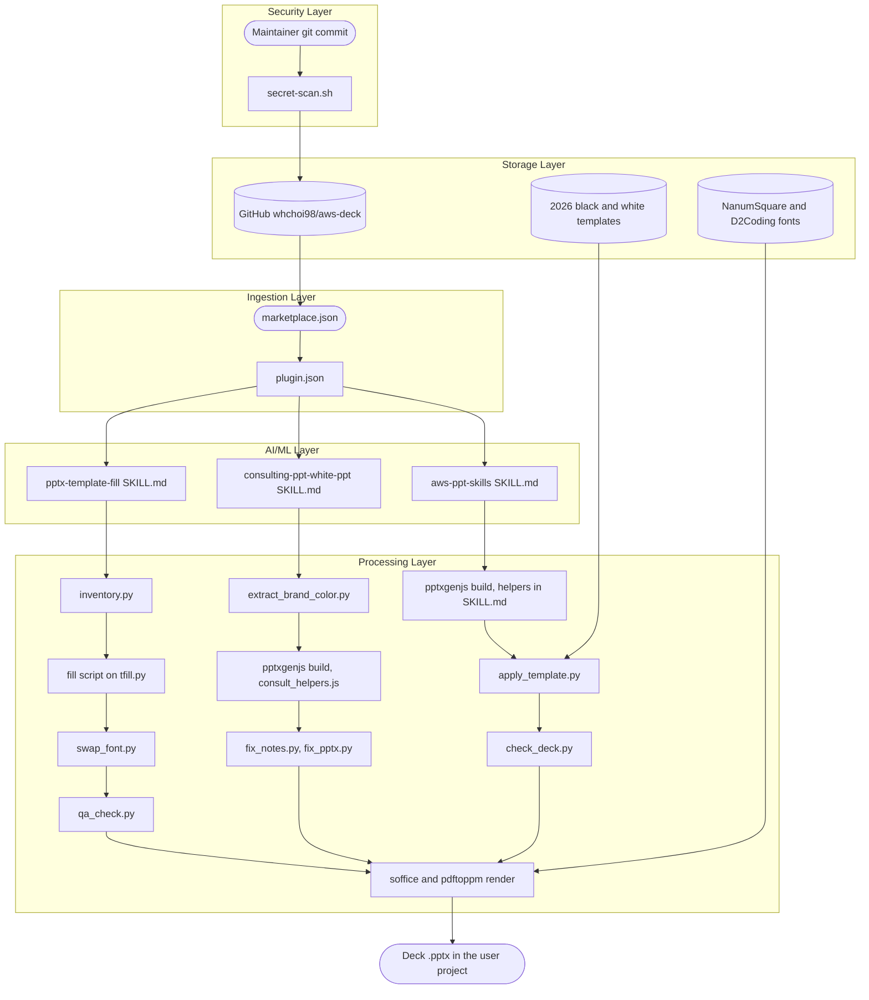
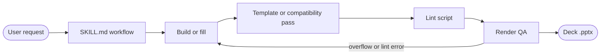

# Architecture

---

# English

## System Overview

aws-deck is a Claude Code plugin marketplace whose single plugin bundles three skills for building AWS Korea PowerPoint decks.
Each skill is a `SKILL.md` workflow that Claude follows, backed by Node.js (pptxgenjs) builders, Python (python-pptx, lxml) post-processors, and LibreOffice plus Poppler for render QA.
A request flows from the skill's workflow through a build or in-place fill, a template or compatibility pass, a lint, and a rendered visual check, and ends as a `.pptx` file in the user's project.

## Components

### Ingestion Layer
- **.claude-plugin/marketplace.json** -- Marketplace `whchoi`, added with `claude plugin marketplace add whchoi98/aws-deck`. Lists the plugin and its source directory.
- **plugins/aws-deck/.claude-plugin/plugin.json** -- Plugin manifest. Installed copies update only when its `version` changes.

### AI/ML Layer
- **plugins/aws-deck/skills/aws-ppt-skills/** -- Seminar decks on the 2026 black or white template. Confirms theme, audience size, presenter, and content before building; diagrams come from the external `aws-diagram` skill and `aws-diagram-design` plugin.
- **plugins/aws-deck/skills/consulting-ppt-white-ppt/** -- Dense, light consulting-report decks (cost and Well-Architected reviews, AS-IS/TO-BE). The accent color comes from the customer's logo.
- **plugins/aws-deck/skills/pptx-template-fill/** -- Fills a template the user supplies while keeping its layout, by editing runs, table cells, and chart caches in place.

### Processing Layer
- **aws-ppt-skills/scripts/** -- `apply_template.py` moves built slides onto the template layouts, `check_deck.py` lints the result, `svg_to_png.py` previews diagrams, and `install_fonts.sh` installs the bundled fonts for QA.
- **consulting-ppt-white-ppt/lib/, tools/** -- `consult_helpers.js` holds the design tokens and slide primitives; `extract_brand_color.py` derives the accent; `fix_notes.py` and `fix_pptx.py` run after every build.
- **pptx-template-fill/scripts/** -- `inventory.py` dumps shape IDs, `tfill.py` is the fill library, `swap_font.py` unifies fonts across the package, and `qa_check.py` checks structure, leftovers, punctuation, fonts, notes, and rendered overflow.

### Storage Layer
- **aws-ppt-skills/assets/** -- The two 2026 templates, the read-only source of backgrounds, logo, footer, and page numbers, and the NanumSquare and D2Coding fonts.
- **references/** -- `diagrams.md` and `recipes.md`, loaded only when a deck needs them.
- **consulting-ppt-white-ppt/examples/** -- A complete reference build (`build_sample.js`) and its output deck.

### Security Layer
- **.claude/hooks/secret-scan.sh**, **.claude/settings.json** -- A gate that blocks a `git commit` containing secrets, and deny rules for destructive commands and `.env` reads. Details: [docs/reference/security.md](reference/security.md).

## Full Architecture Diagram

## Data Flow Summary

## Key Design Decisions

- Build on empty slide masters, then move the slides onto the real template with `apply_template.py` -- the template file stays the only source of backgrounds, logo, footer, page numbers, and embedded fonts, so code never redraws brand elements that could drift from the official template.
- Fill a supplied template in place instead of rebuilding its slides -- convenience APIs such as `text_frame.text` drop run-level formatting, and a rebuilt slide loses the template's styling, so the content is fitted to the layout instead.
- Derive the consulting accent from the customer's logo -- one input sets the whole palette, and a default applies when no logo is given.
- Call bundled files through `$SKILL_DIR` -- a skill runs with the user's project as its working directory, not the plugin directory.
- Bundle the fonts with the plugin -- LibreOffice QA renders with the real typefaces, so overflow found in QA matches the delivered deck.
- Run `fix_pptx.py` after every consulting build -- it repairs cards and bullets that only PowerPoint drops, which a LibreOffice render cannot reveal.

---

# 한국어

## 시스템 개요

aws-deck은 하나의 플러그인에 AWS Korea PowerPoint 덱 제작용 skill 세 개를 묶어 제공하는 Claude Code 플러그인 마켓플레이스입니다.
각 skill은 Claude가 따르는 `SKILL.md` 워크플로이며, Node.js(pptxgenjs) 빌더, Python(python-pptx, lxml) 후처리 스크립트, 렌더 QA용 LibreOffice와 Poppler가 뒷받침합니다.
요청은 skill 워크플로에서 시작해 빌드 또는 제자리 채우기, 템플릿 적용 또는 호환성 보정, 린트, 렌더링 육안 검사를 거쳐 사용자 프로젝트의 `.pptx` 파일로 끝납니다.

## 구성 요소

### Ingestion 계층
- **.claude-plugin/marketplace.json** -- `claude plugin marketplace add whchoi98/aws-deck`로 추가하는 마켓플레이스 `whchoi`입니다. 플러그인과 그 소스 디렉터리를 나열합니다.
- **plugins/aws-deck/.claude-plugin/plugin.json** -- 플러그인 매니페스트입니다. 설치된 사본은 `version`이 바뀔 때만 갱신됩니다.

### AI/ML 계층
- **plugins/aws-deck/skills/aws-ppt-skills/** -- 2026 블랙 또는 화이트 템플릿 기반 세미나 덱입니다. 빌드 전에 테마, 청중 규모, 발표자, 콘텐츠를 확인하며, 다이어그램은 외부 `aws-diagram` skill과 `aws-diagram-design` 플러그인에서 가져옵니다.
- **plugins/aws-deck/skills/consulting-ppt-white-ppt/** -- 비용 및 Well-Architected 리뷰, AS-IS/TO-BE 같은 밝고 밀도 높은 컨설팅 리포트 덱입니다. 강조색은 고객 로고에서 추출합니다.
- **plugins/aws-deck/skills/pptx-template-fill/** -- 사용자가 준 템플릿의 레이아웃을 유지한 채, run, 표 셀, 차트 캐시를 제자리에서 수정해 내용을 채웁니다.

### Processing 계층
- **aws-ppt-skills/scripts/** -- `apply_template.py`는 빌드한 슬라이드를 템플릿 레이아웃으로 옮기고, `check_deck.py`는 결과를 린트하며, `svg_to_png.py`는 다이어그램 미리보기를 만들고, `install_fonts.sh`는 QA용 번들 폰트를 설치합니다.
- **consulting-ppt-white-ppt/lib/, tools/** -- `consult_helpers.js`에 디자인 토큰과 슬라이드 기본 요소가 있고, `extract_brand_color.py`가 강조색을 추출하며, `fix_notes.py`와 `fix_pptx.py`가 매 빌드 후 실행됩니다.
- **pptx-template-fill/scripts/** -- `inventory.py`는 shape ID를 덤프하고, `tfill.py`는 채우기 라이브러리이며, `swap_font.py`는 패키지 전체의 폰트를 통일하고, `qa_check.py`는 구조, 템플릿 잔존물, 구두점, 폰트, 노트, 렌더 기준 넘침을 검사합니다.

### Storage 계층
- **aws-ppt-skills/assets/** -- 배경, 로고, 푸터, 페이지 번호의 읽기 전용 원본인 2026 템플릿 두 개와 NanumSquare, D2Coding 폰트입니다.
- **references/** -- 덱에 필요할 때만 읽는 `diagrams.md`와 `recipes.md`입니다.
- **consulting-ppt-white-ppt/examples/** -- 완성된 참조 빌드(`build_sample.js`)와 그 결과 덱입니다.

### Security 계층
- **.claude/hooks/secret-scan.sh**, **.claude/settings.json** -- 비밀값이 들어간 `git commit`을 차단하는 게이트와, 파괴적인 명령 및 `.env` 읽기를 막는 거부 규칙입니다. 자세한 내용은 [docs/reference/security.md](reference/security.md)를 참조합니다.

## 전체 아키텍처 다이어그램

## 데이터 흐름 요약

## 주요 설계 결정

- 빈 slide master에서 빌드한 뒤 `apply_template.py`로 실제 템플릿에 옮깁니다 -- 배경, 로고, 푸터, 페이지 번호, 임베디드 폰트의 원본을 템플릿 파일 하나로 유지해, 공식 템플릿과 어긋날 수 있는 브랜드 요소를 코드가 다시 그리지 않게 합니다.
- 받은 템플릿은 슬라이드를 다시 만들지 않고 제자리에서 채웁니다 -- `text_frame.text` 같은 편의 API는 run 단위 서식을 지우고, 다시 만든 슬라이드는 템플릿 스타일을 잃으므로, 대신 콘텐츠를 레이아웃에 맞춥니다.
- 컨설팅 강조색은 고객 로고에서 추출합니다 -- 입력 하나로 전체 팔레트가 정해지고, 로고가 없으면 기본값을 씁니다.
- 번들 파일은 `$SKILL_DIR`로 호출합니다 -- skill은 플러그인 디렉터리가 아니라 사용자 프로젝트를 작업 디렉터리로 삼아 실행됩니다.
- 폰트를 플러그인에 함께 넣습니다 -- LibreOffice QA가 실제 서체로 렌더링하므로, QA에서 찾은 넘침이 전달될 덱과 일치합니다.
- 컨설팅 빌드 후에는 매번 `fix_pptx.py`를 실행합니다 -- LibreOffice 렌더로는 드러나지 않고 PowerPoint에서만 사라지는 카드와 글머리표를 복구합니다.
